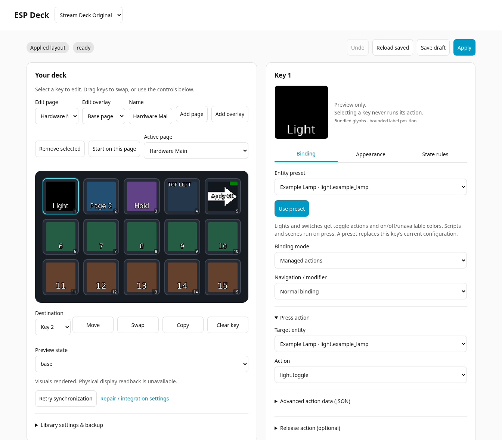
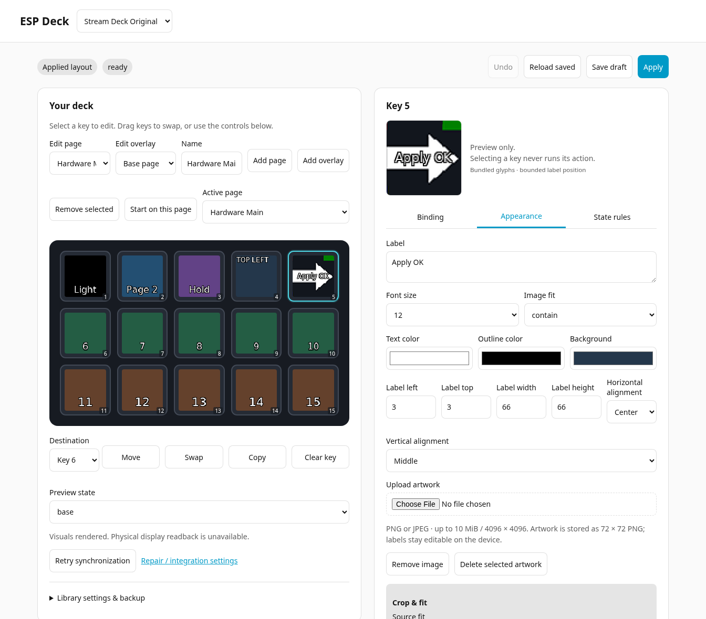
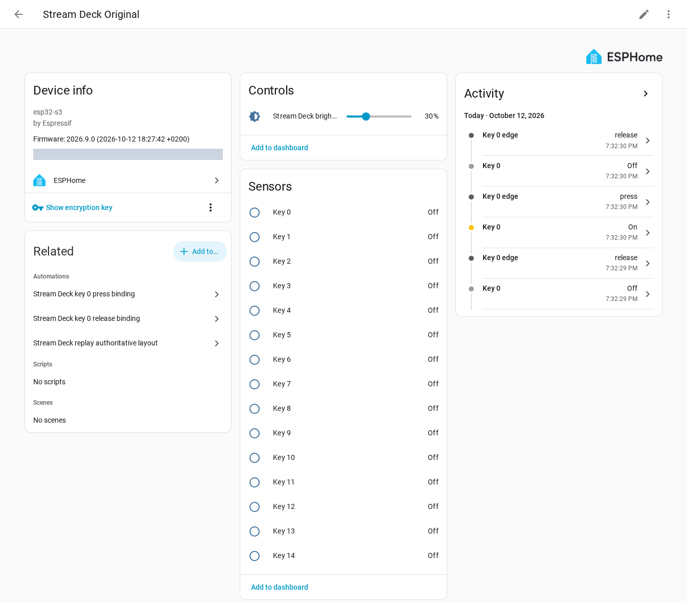

# ESP Deck

Turn an original 15-key Elgato Stream Deck into a Wi-Fi control surface for
Home Assistant, powered by a Seeed XIAO ESP32-S3 Plus and ESPHome.

Home Assistant manages the bindings and layout. The ESP renders the images and
text locally and drives the deck over USB. Once the runtime firmware is installed,
everyday changes happen in Home Assistant without rebuilding firmware.

## Features

- A 5×3 visual editor with light, switch, scene and script bindings.
- PNG/JPEG artwork, editable labels, colors and state-based appearance.
- Named pages, overlays, drag-to-rearrange keys and saved layouts.
- Direct artwork delivery over the encrypted ESPHome API, brightness control
  and encrypted OTA updates.

## Demo

The Home Assistant editor with an existing demo layout:



<details>
<summary>Artwork editing and ESPHome device controls</summary>

Edit artwork and labels, and inspect brightness, key states and activity in
Home Assistant. Click an image to view it at full size.

[](docs/images/ha-appearance.png)
[](docs/images/esphome-device.png)

</details>

## Get started

Supported hardware: **Stream Deck Original `0FD9:0060`** and
**XIAO ESP32-S3 Plus**, using ESP-IDF. Home Assistant **2026.10.1+** is required.

1. Review the [wiring and power checklist](docs/hardware.md).
2. Follow the [firmware setup guide](docs/getting-started.md) to install
   [example 05](examples/05_home_assistant_runtime.yaml).
3. [Install the ESP Deck integration](docs/ha-integration.md#installation-and-guided-setup),
   pair the device through ESPHome, then add ESP Deck in **Settings → Devices & services**.
4. Open **ESP Deck** in the sidebar, choose bindings and artwork, and **Apply**.

Native USB is dedicated to the deck; logs use UART0. Power comes from one external
5 V source with unswitched VBUS. Disconnect that feed and the deck adapter before
connecting a computer to the XIAO's USB-C port.

## Development

With Python 3.14, Git, C99 and C++17 compilers:

```sh
python3 -m venv .venv
.venv/bin/python -m pip install -r requirements-lock.txt
.venv/bin/python -m unittest discover -s tests -v
.venv/bin/python tools/check_firmware.py --compile
```

No board is needed. Validation builds use synthetic secrets and **must not be
flashed**. See [development and testing](docs/development.md) for frontend checks,
fixtures and the isolated HA lab.

## Status

| Evidence | Current baseline |
| --- | --- |
| Implemented | Firmware, HA integration, visual editor, artwork uploads and pages |
| Compiled | Seven configurations on ESPHome 2026.9.0 / ESP-IDF 5.5.5 |
| Unit-tested | Protocol fixtures, rendering, scheduling, HA backend and frontend |
| Hardware-verified | Initial image/input, API/OTA, artwork-transfer and page-navigation checks |

This is a working prototype. Physical appearance of the latest uploaded artwork,
electrical qualification, repeated recovery and soak testing remain pending.
See [test evidence](docs/testing.md) and [release qualification](docs/release.md).

[Editor guide](docs/visual-editor.md) · [USB architecture](docs/decisions/usb-transport.md) ·
[License](LICENSE) · [Third-party notices](THIRD_PARTY_NOTICES.md)
