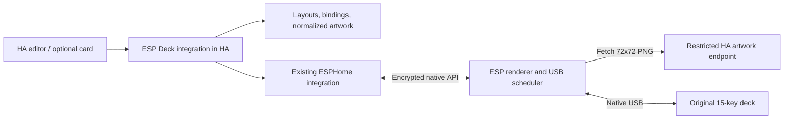

# HA test lab and guided configuration

Research and recommended design, 2026-10-11. This extends the owner's requested
direction after P4; it is not an implemented integration or a container test result.
Implementation stages and acceptance gates are in [the plan](../implementation-plan.md).

P5 follow-up, 2026-10-11: the [isolated lab](../ha-lab.md) is now implemented,
compiled and tested against HA 2026.10.1, including real encrypted native-API
sessions and a browser smoke test. This records the decision's execution;
the integration/editor/upload/pages design below remains P6–P9 work.

## Decision: one integration with a bundled editor

Build `custom_components/esp_deck/` as a HACS-distributed custom integration with
a bundled sidebar editor. Keep an optional dashboard card as a thin view/control
of that same backend. Layout storage, entity subscriptions, bindings, revisions
and reconnection run in HA even when no browser is open. A separate container
or desktop bridge is needed only for development/testing, not for deployment.

This packaging follows HACS's integration layout: one integration under
`custom_components`, with its runtime files inside that directory. HA supports
custom sidebar panels; the inspected `panel_custom` API can register a module
and associate its configuration panel with an integration. Serving that compiled
module from the integration avoids a required second frontend installation or
manual dashboard-resource entry. This is our design choice based on those APIs,
not a ready-made ESP Deck editor supplied by HA.
[HACS requirements](https://hacs.xyz/docs/publish/integration/),
[custom panels](https://developers.home-assistant.io/docs/frontend/custom-ui/creating-custom-panels/),
[panel API at HA 2026.10.1](https://github.com/home-assistant/core/blob/2026.10.1/homeassistant/components/panel_custom/__init__.py).

Use the existing ESPHome integration for connectivity, credentials, key events
and native action execution. The custom integration selects an existing device
and resolves registry IDs/action names automatically, with an advanced repair
flow for ambiguous or renamed devices. The inspected HA ESPHome manager registers
native actions with response support and derives their names from the node name.
Prefer HA service calls and entity subscriptions; isolate any unavoidable use
of ESPHome runtime metadata in one adapter with version tests. Do not take over
its reconnect client or create a second permanent native API connection.
[ESPHome manager at HA 2026.10.1](https://github.com/home-assistant/core/blob/2026.10.1/homeassistant/components/esphome/manager.py).

HA's current device registry restricts device ownership to one config entry.
Follow the helper-integration linking pattern for additional controller entities;
do not add a second owner to the ESPHome device. Also account for integration
dependencies loading before their individual config entries are ready.
[Helper linking](https://developers.home-assistant.io/blog/2025/07/18/updated-pattern-for-helpers-linking-to-devices/),
[device ownership](https://developers.home-assistant.io/blog/2026/07/21/device-registry-single-config-entry/),
[manifest/dependency rules](https://developers.home-assistant.io/docs/creating_integration_manifest/).

## User journey

After the initial compatible ESPHome firmware/network setup:

1. Install ESP Deck through HACS, restart HA when required, then add the integration.
2. Pick the discovered ESPHome deck. The setup checks supported actions/session,
   display dimensions and the artwork address; users do not enter revision IDs,
   action prefixes, presence masks or per-key sensor names.
3. Open a front-view **5-column × 3-row** editor, select a key, and choose an entity,
   script/scene or action. A light preset supplies toggle behavior and on/off/
   unavailable artwork; complex automation stays in HA's automation/script UI.
4. Upload an image, crop/fit it, choose label/font/colors, preview, and Apply.
   Move/swap/copy keys using drag-and-drop or accessible buttons. Selecting a key
   or previewing artwork does not execute its binding.
5. Add pages or a modifier layer when supported. Show saved, updating, ready,
   offline and failed states with a retry/repair path; never label `rendered` as
   physical display readback. Advanced diagnostics can expose revision details.

Store drafts separately from the applied layout, support undo/copy/import/export,
and validate the entire configuration before activation. Save on explicit edits,
not on every entity state update. Only one backend writer sends visuals; the P4
YAML replay/binding examples must be disabled when the integration takes control.

## A local lab is practical and independent of production HA

Read-only checks on this workstation found Fedora 44, Podman 5.8.4, rootless mode,
Netavark and enforcing SELinux. Nothing was listening on TCP 8123 or 18123 during
the check; no HA container/image was present. No container was created or started.
HA documents its Container image as compatible with OCI runtimes, which makes
Podman a reasonable lab choice. Supervisor apps are unnecessary for a custom
integration or HACS. [HA Container](https://www.home-assistant.io/installation/linux/#install-home-assistant-container).

Use a pinned HA release and image digest, initially evaluating 2026.10.1 against
the source inspected here. Keep fresh config/database/tokens under an ignored
private `.build/ha-lab/` directory. Publish the UI on `127.0.0.1:18123`; place HA
and a virtual deck in a dedicated rootless network, with explicit addresses
instead of relying on mDNS. Use only lab-owned bind paths with the required
SELinux label (`:Z` for a private mount). Do not relabel the workspace or disable
SELinux. A software lab needs no USB device, privileged mode, host network or
D-Bus mount. These are planned constraints to verify during P5.
[Podman networking/volume options](https://docs.podman.io/en/latest/markdown/podman-run.1.html).

Run three complementary layers:

| Test layer | Establishes | Does not establish |
| --- | --- | --- |
| HA pytest tests and fake transport | Config flow, migrations, permissions, bindings, coalescing and failures | A real HA/frontend/native-API session |
| Real HA Container + test-only virtual deck + browser tests | Real action responses, event delivery, upload/editor, restart/reload and closed-browser behavior | IDF/USB/DMA timing, real ESP networking or panel output |
| Later supervised ESP/deck tests, optionally using the lab HA | Actual fetch/render/input/OTA/reconnect and measured resource use | Electrical/release qualification unless those gates also pass |

The locally pinned ESPHome includes a `host` target. Start P5 with a small
feasibility test: use its real encrypted native API and a test-only adapter
linking our portable visual store, renderer and scheduler with simulated USB.
Reuse the P4 action signature; don't hand-implement another Noise/protobuf server
or claim the ESP32-only wrapper/IDF HTTP worker is running on the host. Simulate
press/release, reboot, delayed completion and failure through a test interface.
Add a real host HTTP fetch adapter for lab asset delivery separately from the
existing fake-loader unit tests. [ESPHome host platform](https://esphome.io/components/host/).

Mount/copy the custom integration directly while developing; this exercises the
same code without HACS or a GitHub login in every test. HACS's own installation
smoke test is separate because its onboarding uses GitHub device OAuth. Do not
make that external account flow a dependency of offline tests or invent account
credentials. [HACS onboarding](https://hacs.xyz/docs/use/configuration/basic/).

## Upload once; send small, reusable artwork

Upload to HA, not to the ESP API. Proposed initial limits: PNG/JPEG only, 10 MiB
encoded input, at most 4096 on either axis and 16,777,216 source pixels; one
conversion at a time and a bounded pending queue. Validate decoded content,
reject animation/truncated files/decompression bombs, apply EXIF orientation,
strip metadata, normalize color and produce a non-interlaced **72×72 PNG**.
Bound the library as well as individual files, with reference-aware deletion.
Pillow operations/file I/O run off HA's event loop and use the version supplied
by the pinned HA release, without changing the firmware fixture environment.
[Pillow image limits](https://pillow.readthedocs.io/en/stable/reference/Image.html),
[HA blocking-work guidance](https://developers.home-assistant.io/docs/asyncio_blocking_operations/).

Crop/zoom/offset and any static artwork composition happen before normalization.
Preserve alpha where needed; let the ESP compose the background and dynamic label.
Do not bake changing text into each downloaded image or pre-flip to native BMP.
The existing local renderer applies orientation exactly once. Preview should
reuse the bundled glyph data/layout fixtures; browser font rasterization alone
does not prove pixel-equivalent outlined text.

A normalized RGBA image contains 20,736 pixel bytes. Set an initial canonical
PNG ceiling of 32 KiB and verify outputs with the production decoder. Content
hashes identify immutable asset variants and populate `image_revision`. Label
changes keep that identity and reuse the cached background. This reduces network
payload and source-decoder work; it does **not** shrink the fixed 15,606-byte BMP
or the two 8191-byte USB reports. The ESP's existing memory/byte limits remain.

Core HA's image-upload code is useful precedent, but its inspected thumbnail
service only accepts 256/512 square sizes and serves originals as uploaded.
Implement deliberate 72×72 normalization; don't assume an HA thumbnail URL is
already an appropriate deck asset.
[Image upload implementation at HA 2026.10.1](https://github.com/home-assistant/core/blob/2026.10.1/homeassistant/components/image_upload/__init__.py).

### Asset access and first setup

The current ESP accepts configured HTTP(S) origins, has no auth-header support,
and rejects query strings. Browser-authenticated image proxies or signed media
URLs therefore cannot simply be forwarded. Recommended initial design: an
integration-owned download route with an unguessable, revocable, per-device
read-only capability in its **path**, restricted to that device's referenced
normalized assets. Upload/editor/list/delete operations still require HA user
authentication and authorization. No HA administrator token goes to the ESP.

Treat this path as a credential: don't log/export it, rate-limit invalid requests,
test revocation and access across devices, and retain old assets while referenced
or in flight. Plain LAN HTTP artwork remains non-sensitive; a secret path does
not encrypt traffic. Use validated HTTPS where the deployment supports it.
This is a new endpoint design to implement/test, not a property already provided
by `/local/` or an assertion that current firmware has authenticated media support.

The existing origin allowlist is compiled into firmware. P6 can work with its
configured HA origin; setup must explain a mismatch. For the final guided flow,
P8 adds a bounded authenticated provisioning operation for the selected origin
and reports capabilities/configuration. Persist only deliberate origin changes,
not layouts or label updates. Keep exact-origin enforcement, certificate/date
validation and the existing public-CA configuration; private-CA upload remains
advanced. An HA browser URL, `localhost`, container alias or cloud URL is not
automatically reachable by the ESP. The wizard must verify a device-side fetch.

## Pages, layers and position need explicit semantics

Moving a key between physical slots needs only an HA layout edit with P4.
Image offsets can be baked into the normalized raster. Arbitrary **label**
position/alignment is absent from v1 and needs a versioned renderer/API extension;
it must not be presented as an existing option.

Keep named pages and sparse modifier overrides in HA, with initial caps of
8 pages and 4 overlays per deck. Define a deterministic precedence order, one
active overlay initially, and empty-vs-inherited fields. Resolve only the active
15 tiles onto the ESP. Reset momentary layers on restart, disconnect or input
resynchronization; never restore a held modifier from saved state. Here “layer”
means a logical override, not unlimited graphical layers or another ESP framebuffer.

There is a safety/usability gap to close before enabling physical page/layer
bindings: P4 reports `rendered` when pixels reach the scheduler, while the deck
updates keys serially. Switching all bindings immediately can make an old visible
icon perform a new action. P8 must correlate input with the applied layout/key
revision and USB generation, gate affected controls during transitions, and test
delayed events and held keys. A fixed delay or `rendered` acknowledgement alone
is insufficient. The exact versioned input/ack channel is a P8 design spike;
keep advanced navigation unavailable until its ordering tests pass. Whole-deck
visual atomicity is not promised by this device's protocol.

## Distribution and remaining decisions

Start with direct local installation, then HACS custom-repository installation.
Prepare `hacs.json`, manifest/config flow, translations, brand/license assets,
compiled frontend, HACS validation and Hassfest. A public GitHub release and
default-store submission are distinct publishing steps; default inclusion is
not required for users to add a compatible custom repository.
[Custom repositories](https://hacs.xyz/docs/faq/custom_repositories/),
[default inclusion](https://hacs.xyz/docs/publish/include/).

Resolve and record during implementation: tested/minimum HA and HACS versions,
the narrow ESPHome adapter's compatibility surface, frontend selector reuse,
origin-provisioning and page/input protocol v2, asset retention quotas, and
real device timing. The basic P6/P7 editor should remain usable with v1 firmware;
advanced fields are capability-gated. Neither the user's production HA nor new
hardware measurements are prerequisites for P5–P8 software development.
